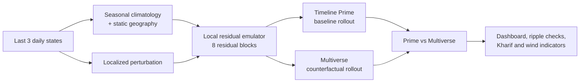
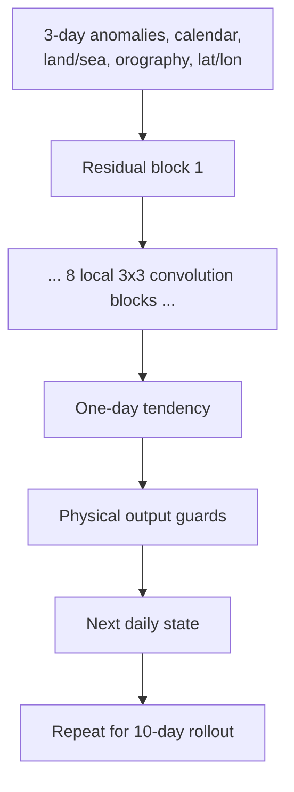

<h1 align="center">Monsoon Multiverse</h1>

<p align="center">
  <strong>An offline climate digital twin for India's monsoon - forecast the next 10 days, then explore what-if scenarios.</strong>
</p>

<p align="center">
  <a href="#quick-start">Quick start</a> · <a href="#architecture">Architecture</a> · <a href="#dashboard">Dashboard</a> · <a href="#validation">Validation</a> · <a href="#limitations">Limitations</a>
</p>

<p align="center">
  <a href="https://huggingface.co/spaces/aryan273k/monsoon-multiverse"><strong>Open the live demo on Hugging Face</strong></a>
  <br>
  <sub>Dashboard and API are hosted there; the local run below is the reference.</sub>
</p>

<p align="center">
  
  
  
  
  
</p>

## Overview

**Monsoon Multiverse** is a fast, deterministic emulator of daily weather over India. Starting from three days of atmospheric state, it produces a baseline **Timeline Prime** forecast. Apply a local perturbation - for example warmer Bay of Bengal air or stalled monsoon winds - and it creates a **Multiverse** branch, making the modeled response and its spread visible.

Built for **Yugaantar DevForge, Track 2: “Multiverse of Monsoon,”** the project is offline-first: trained weights, samples, static map assets, fonts, FastAPI service, and dashboard are shipped in this repository.

| Capability | What it provides |
| --- | --- |
| Forecasting | 10-day daily rollouts for six surface variables on a 1-degree India grid |
| Counterfactuals | Local temperature, humidity, wind, pressure, and rainfall shocks |
| Bounded causality | Responses can travel at most 8 grid cells per simulated day by design |
| Explainable exploration | Prime/Multiverse maps, timeline fork, ripple checks, and place-level views |
| Impact signals | Kharif stress comparison and wind-power proxy, live from model output |

## Demo

https://github.com/user-attachments/assets/cce7db3f-3ae8-4139-af74-d28bc9ea8d9c

## Quick start

### 1. Create an environment

```powershell
python -m venv .venv
.\.venv\Scripts\Activate.ps1
pip install -r requirements.txt
```

> Linux/macOS: use `source .venv/bin/activate`.

### 2. Start the model server

From the repository root:

```powershell
python serve.py --port 8000
```

The service listens at `http://127.0.0.1:8000`; use `POST /health` to check readiness.

### 3. Start the dashboard

In a second terminal at the repository root:

```powershell
python dashboard/devserver.py --port 8080
```

Open [http://127.0.0.1:8080/?server=api](http://127.0.0.1:8080/?server=api). The dashboard forwards `/api/*` to the model server, retaining a single browser origin. Add `?view=expert` for the scientific interface.

### 4. Verify the installation

```powershell
python tests/test_contract.py
node --test dashboard/tests/*.test.mjs
```

The server is designed to be ready in roughly four seconds. A 10-day ensemble rollout typically takes about 0.5-1 second on four CPU cores.

## Architecture



The emulator predicts a one-day **tendency** rather than replacing each state. It learns anomalies relative to a smooth seasonal climatology (three Fourier harmonics per grid cell and variable), so longer simulations relax toward a sensible seasonal state instead of drifting.



| Design choice | Rationale |
| --- | --- |
| 8 local residual blocks, width 96 | 3x3 convolutions impose a hard maximum reach of 8 cells/day; there is no global attention, FFT, or batch-wide statistic. |
| `log1p` rainfall target | Makes heavy-tailed rainfall easier to learn while guards keep rainfall and water vapour non-negative. |
| Unrolled training | One-step training progresses to 2- and 4-day rollouts, teaching the model to correct its own errors. |
| Three-seed ensemble | Averages deterministic local models to reduce member-specific error and stabilize shock magnitude. |
| Per-lead calibration | Least-squares anomaly gains shrink longer leads toward climatology; rainfall is not scaled to preserve heavy-rain signals. |

### API contract

`POST /simulate` accepts initial physical states, calendar signal, forecast length, and an optional perturbation:

```json
{
  "init_states": "[3, 6, 32, 36] physical-unit tensor",
  "doy_sincos": [0.0, 1.0],
  "steps": 10,
  "perturbation": null
}
```

It returns a rollout shaped `[steps, 6, 32, 36]` and inference timing. A zero shock produces a bit-identical baseline forecast.

## Dashboard

The default **Forkline** experience shows a 3D relief map and a timeline that divides into Prime and Multiverse paths. Move and zoom the map, select a place, tune a scenario, compare branches, or trace the response limit day by day. WebGL2 enables the 3D map; `?flat=1` forces a 2D fallback.

| View or tool | Purpose |
| --- | --- |
| Change / Prime / Multiverse / Compare | Inspect deltas, either branch, or both with a draggable divider. |
| What if | Use common or extreme presets, or build a custom localized shock. |
| Influence | Runs systematic local changes to show which areas affect a chosen place. |
| Proof | Shows held-out skill, timing, request count, live checks, and scenario JSON. |
| Expert view | Scientific interface with synchronized maps, cell series, shock painter, ripple tab, and null-shock check. |

### Impact indicators

All impact figures are calculated live from paired `/simulate` responses.

- **Kharif Stress Monitor:** 10-day rainfall change, longest dry spell, heat-stress days, and an overall state/UT stress tier.
- **Wind-power index:** capacity-factor proxy for six major wind states using 10 m wind extrapolated to hub height and a generic turbine curve.
- **Watch levels:** scenario-comparison thresholds for rain, temperature, and wind; informational only, never public warnings.

## Validation

The validation recipe trains on **2005-2018** and evaluates the held-out **2019-2021** period. Submitted weights are retrained on all **2005-2021** data, so final weights are not scored against their own training years.

| Lead time | Skill vs best reference | Skill vs persistence |
| --- | ---: | ---: |
| Day 1 | **+0.32** | +0.34 |
| Day 4 | **+0.07** | +0.26 |
| Day 8 | -0.01 | +0.24 |

Skill is `1 - RMSE / RMSE(best of persistence or day-of-year climatology)`, latitude-weighted and assessed per lead. Held-out checks also report heavy-rain CSI of 0.29 (vs 0.19 persistence), preserved spatial variance, deterministic null shocks, and localized day-1 shock response.

## Reproduce training

Training data lives outside the repository and must not be committed. From the project root:

```bash
for s in 0 1 2; do
  python training/train.py --data ../data/india_climate_train.nc --train-end 2021 --width 96 --depth 8 \
    --stages 1:40,2:10,4:10 --lrs 1e-3,3e-4,2e-4 --seed $s --out runs/seed$s.pt --device cuda
  python training/calibrate.py --ckpt runs/seed$s.pt --data ../data/india_climate_train.nc --train-end 2021 --stride 4
done
python training/make_ensemble.py --out weights/emulator.pt runs/seed0.pt runs/seed1.pt runs/seed2.pt
```

See [`TRAINING.md`](TRAINING.md) for calibration, grading, validation, and GPU runbook details.

## Repository map

```text
.
├── serve.py                 # FastAPI inference server
├── monsoon/model.py         # emulator, climatology, rollout, and guards
├── weights/emulator.pt      # calibrated three-member ensemble
├── training/                # training, calibration, and ensemble scripts
├── dashboard/               # offline interactive web dashboard and impact module
├── tests/                   # contract and UI checks
├── tools/model_adapter.py   # evaluation adapter
├── TRAINING.md              # detailed training/evaluation runbook
└── project-demo-compressed.mp4
```

## Limitations

- The model uses a 1-degree daily grid and six surface variables. It has no SST, upper-air fields, or boundary inflow; edge regions are least reliable.
- By days 8-10, skill is near climatology and intentionally damped; do not infer fine weather detail at those leads.
- Rainfall is the most difficult target; heavy-rain cells can be displaced by 1-2 grid cells.
- Counterfactuals are learned statistical responses, not a conservation-based physics simulator. Magnitude is a hypothesis, especially for extreme or out-of-distribution shocks.
- Agricultural and wind indicators compare model branches; they are not validated decision advice.
- State boundaries are Natural Earth public-domain geometry and are indicative only.

## Data, attribution, and license

The model was trained only on the organizer-provided `india_climate_train.nc` dataset for 2005-2021. Nothing is downloaded at runtime. Dashboard geography uses Natural Earth boundaries, GeoNames places (CC BY 4.0), NASA Blue Marble imagery, and NOAA ETOPO 2022 relief; see [`dashboard/README.md`](dashboard/README.md) for full asset information.

Code is released under the [MIT License](LICENSE). Bundled dashboard fonts use the SIL Open Font License.
